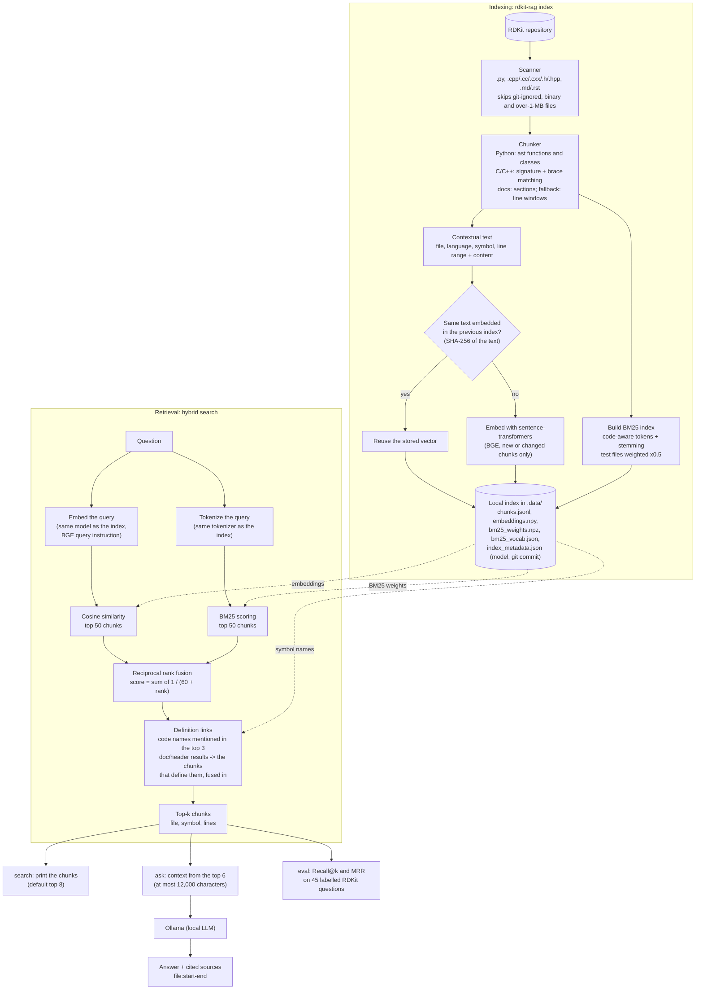

# rdkit-rag

[](https://github.com/rezabagher/rdkit-rag/actions/workflows/tests.yml)

rdkit-rag is a local question-answering tool for the
[RDKit](https://github.com/rdkit/rdkit) cheminformatics codebase. RDKit is a
large mix of C++ and Python, about 2,200 source and doc files, and it's hard
to find where a feature is implemented: `grep` only finds exact words, and the
whole repo is far too big to paste into an AI model. rdkit-rag splits the code
into meaningful pieces (Python functions via the `ast` module, C++ functions
via signature and brace matching, docs by section). It turns each piece into
an embedding vector stored on disk, and when you ask a question in plain
English it finds the most relevant pieces by cosine similarity. A local LLM
running in [Ollama](https://ollama.com) then answers from that code and cites
the exact files and line numbers it used. Everything runs on your own machine
with no API keys or cloud services. Developers can explore an unfamiliar
codebase in natural language and check every claim against the real source.

This is a beta release (0.1). It favors simplicity and readability over
completeness - see [Current limitations](#current-limitations).

## Architecture

Indexing runs once, then again after each `git pull`; queries read the
stored index. GitHub renders the diagram below; elsewhere it shows as
Mermaid source.



`--mode vector` and `--mode keyword` use only one branch of the retrieval
step, without fusion or definition links; keyword mode never loads the
embedding model.

## Requirements

- Python 3.11+
- [Ollama](https://ollama.com) installed and running locally (only needed
  for `rdkit-rag ask` - not for `index` or `search`)
- A local clone of the RDKit repository (or any codebase, really)

## Installation

```bash
git clone https://github.com/rezabagher/rdkit-rag.git
cd rdkit-rag
pip install -e ".[dev]"
```

This installs the `rdkit-rag` CLI along with its runtime dependencies
(`typer`, `pydantic`, `sentence-transformers`, `numpy`, `scipy`, `ollama`,
`python-dotenv`) and `pytest` for running the test suite.

Without an NVIDIA GPU, install the CPU-only build of PyTorch first; it is
about 2 GB smaller than the default:

```bash
pip install torch --index-url https://download.pytorch.org/whl/cpu
```

## Ollama setup

1. Install Ollama: https://ollama.com/download
2. Start the server (usually automatic after install, or run `ollama serve`).
3. Pull a model, e.g.:

   ```bash
   ollama pull qwen3:8b
   ```

4. Make sure `OLLAMA_MODEL` (see below) matches the model you pulled.

`rdkit-rag ask` checks that Ollama is reachable and that the configured
model (exact tag, e.g. `qwen3:8b` is not satisfied by `qwen3:1.7b`) is available before doing any retrieval work, and prints a clear
error if not. `rdkit-rag index` and `rdkit-rag search` don't need Ollama
at all.

## Configuration

Copy `.env.example` to `.env` and adjust as needed:

```bash
cp .env.example .env
```

```ini
EMBEDDING_MODEL=BAAI/bge-small-en-v1.5   # any sentence-transformers model
OLLAMA_MODEL=qwen3:8b                    # any model you've `ollama pull`ed
OLLAMA_HOST=http://localhost:11434       # default Ollama host
```

No API keys are required anywhere.

## Usage

### 1. Index a repository

```bash
rdkit-rag index /path/to/rdkit
```

This scans supported files, chunks them, generates embeddings, and stores
everything under `.data/` in the current directory. If the target is a git
checkout, git-ignored files are skipped (e.g. the third-party sources RDKit's
CMake build downloads into `External/`).

#### Keeping the index up to date

RDKit changes every day, but you never need to rebuild from scratch. After
`git pull` (or checking out another branch), run the same command again:

```bash
rdkit-rag index /path/to/rdkit
```

Re-running re-chunks the repository (a few seconds) and reuses the stored
embedding of every chunk whose text didn't change. Only new or changed code
is embedded, which is the slow part. Deleted files drop out of the index. The
result is the same as a full rebuild. The output shows what happened, e.g.
`Updated: 37 new/changed chunks embedded, 24,967 reused`, and the index
records the git commit it was built from.

To update automatically after every pull or merge, add a `post-merge` hook to
your RDKit checkout (`/path/to/rdkit/.git/hooks/post-merge`, made executable
with `chmod +x`):

```sh
#!/bin/sh
cd /path/to/rdkit-rag && rdkit-rag index /path/to/rdkit
```

To ignore the stored embeddings and re-embed everything:

```bash
rdkit-rag index /path/to/rdkit --force
```

Changing `EMBEDDING_MODEL` triggers a full re-embed automatically.

### 2. Search (no LLM required)

```bash
rdkit-rag search "Where is molecule sanitization implemented?"
rdkit-rag search "How are SMILES parsed?" --top-k 5
```

Prints the top matching chunks with file, symbol, and line-range info plus
the chunk content.

By default search is **hybrid**: it ranks chunks both by meaning (cosine
similarity of embeddings) and by keywords (BM25), then merges the two
rankings with reciprocal rank fusion. Each result shows its rank in both,
e.g. `(vector #4, keyword #1)`. Use `--mode` to pick one method:

```bash
rdkit-rag search "MolToSmiles" --mode keyword   # exact names; fast, no embedding model
rdkit-rag search "how are rings perceived" --mode vector
```

Hybrid search also follows **definition links**. A plain-English question
is often matched best by text that explains the concept, such as a section
of the RDKit Book or a commented declaration in a header, while the code
that implements it uses different words. Those texts name the functions
involved, so the code names mentioned in the top 3 documentation and header
results (e.g. `findSSSR`, `SanitizeMol`) are looked up among the indexed
definitions, and the defining chunks are merged into the ranking. Such
results are marked, e.g. `(defines FastFindRings in
Docs/Book/RDKit_Book.rst)`. Only names that look like code (camelCase or
snake_case) are followed, and declarations in headers and test code are
skipped as targets.

The keyword index is code-aware: identifiers are matched whole and by their
camelCase / snake_case parts (`MolToSmiles` also matches "smiles"), related
word forms are merged (kekulization / kekulize), and test files are ranked
below implementation files that use the same words. It is built during
`rdkit-rag index`; indexes made with older versions get it built
automatically, in a few seconds, on first search.

`ask` accepts the same `--mode` option.

### 3. Ask a question (uses Ollama)

```bash
rdkit-rag ask "How does RDKit sanitize a molecule?"
rdkit-rag ask "How does RDKit sanitize a molecule?" --top-k 8 --show-context
```

Retrieves relevant chunks, builds a bounded context window, sends it to the
local Ollama model along with the question, and prints the answer followed
by the exact sources it was grounded in:

```
ANSWER

RDKit sanitization is handled primarily by ...

SOURCES USED

1. Code/GraphMol/MolOps.cpp:123-180
2. Code/GraphMol/testMolOps.cpp:45-90
```

### 4. Measure retrieval quality

```bash
rdkit-rag eval                 # all three search modes side by side
rdkit-rag eval --mode hybrid --details
rdkit-rag eval --output results.json
```

The built-in question set (`src/rdkit_rag/data/rdkit_questions.toml`,
installed with the package) holds 45 questions about RDKit, each with the
file (and usually the function) where the answer is implemented, checked
against a pinned RDKit commit. `rdkit-rag eval` runs them through search and
reports Recall@k (share of questions with a relevant chunk in the top k) and
MRR (mean reciprocal rank of the first relevant chunk), overall and per
category:

- **concept**: plain-English questions with no code names
  ("How are tautomers enumerated?")
- **identifier**: questions that name the function ("Where is sanitizeMol
  implemented?")

Only the primary implementation counts as relevant; a header, wrapper or
documentation hit counts as a miss, so the scores are a lower bound. It warns
if a listed location is missing from the index (e.g. after RDKit renamed a
file).

Baseline (RDKit `ce08c344e`, `BAAI/bge-base-en-v1.5`, full results in
`eval/baseline.json`). To reproduce it, index that RDKit commit with
`EMBEDDING_MODEL=BAAI/bge-base-en-v1.5`; the default `bge-small` model gives
different vector and hybrid scores (keyword scores don't depend on the
model):

| mode    | R@1  | R@5  | R@10 | MRR  | concept R@10 | identifier R@10 |
|---------|------|------|------|------|--------------|-----------------|
| hybrid  | 0.42 | 0.58 | 0.62 | 0.47 | 0.43         | 1.00            |
| vector  | 0.18 | 0.40 | 0.44 | 0.26 | 0.23         | 0.87            |
| keyword | 0.29 | 0.40 | 0.49 | 0.35 | 0.30         | 0.87            |

Definition links (see [search](#2-search-no-llm-required)) raised hybrid
concept R@10 from 0.27 to 0.43 and MRR from 0.14 to 0.30. Because that
method was chosen while looking at these 45 questions, it was then checked
once on 18 new concept questions written afterwards
(`eval/heldout_questions.toml`, results in `eval/heldout_results.json`):
hybrid R@10 went from 0.33 to 0.44 and MRR from 0.11 to 0.32 there, too.

```bash
rdkit-rag eval eval/heldout_questions.toml
```

Concept questions are still the weak spot: more than half don't find the
implementing code in the top 10, usually because the documentation that
explains the concept never names the function.

To evaluate another codebase, write a question set in the same format and
pass its path: `rdkit-rag eval my_questions.toml`.

## Running tests

```bash
pytest
```

Tests use small fixture strings/files rather than the full RDKit repository,
and the embedding model is mocked in retrieval tests so no model download
is required to run the suite.

## Current limitations

- No reranking step after hybrid retrieval. On the built-in benchmark,
  plain-English "how does X work" questions find the implementing code in
  the top 10 a little under half the time (identifier questions: 100%).
- C/C++ chunking is heuristic (signature detection + brace counting), not a
  real parser. It handles typical function/method definitions well but can
  miss unusual formatting; it falls back to overlapping line-based chunks
  when it can't confidently find functions in a file.
- No call graph or cross-reference analysis.
- No Python/C++ binding detection (e.g. linking `rdkit.Chem` Python calls to
  their C++ implementations). Definition links therefore take a Python name
  in the docs, such as `GetSSSR`, to its Boost.Python wrapper rather than to
  the C++ function the wrapper calls (`findSSSR`).
- No test-to-implementation relationship detection.
- The index records which embedding model built it, and `search`/`ask`
  always embed queries with that model. Changing `EMBEDDING_MODEL` takes
  effect at the next `rdkit-rag index`, which then re-embeds everything.
- An edit near the top of a file shifts the line numbers of the chunks below
  it, and line numbers are part of the embedded text, so those chunks are
  re-embedded too. Updates stay per-file, never whole-repository.
- Designed for a single local repository, not for scaling to many
  repositories or many concurrent users.

See [ROADMAP.md](ROADMAP.md) for planned work.

## Contributing

Bug reports and pull requests are welcome; see
[CONTRIBUTING.md](CONTRIBUTING.md). Changes are listed in
[CHANGELOG.md](CHANGELOG.md).

## License

rdkit-rag is released under the BSD 3-Clause License, the same license as
RDKit. See [LICENSE](LICENSE).
